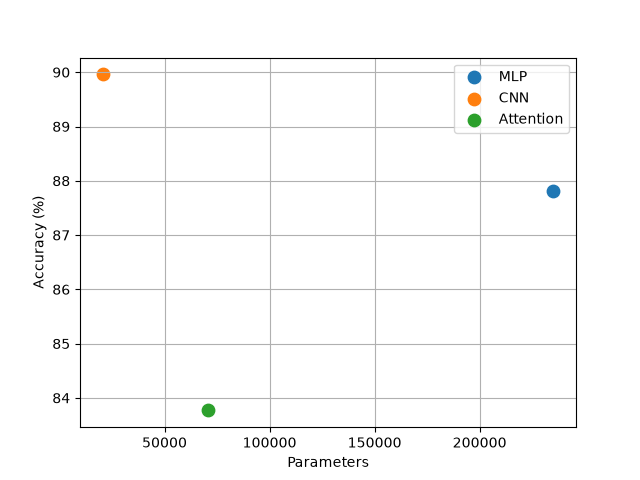
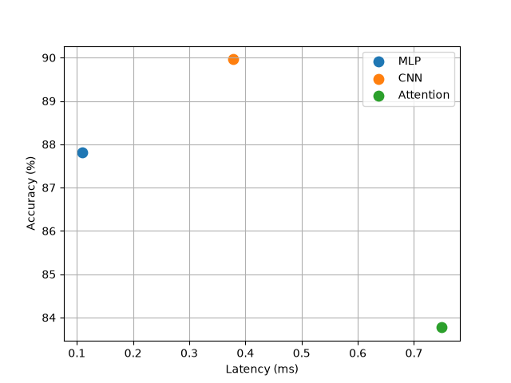

# Lab 3 (71616)

Fashion-MNIST: 55k train, 5k validation, 10k test.

Adam, lr=0.001, 5 epochs, batch size 128.

Device: cpu

| Model | Params | FLOPs (THOP) | Accuracy | Batch 1 | Batch 128 |
|---|---:|---:|---:|---:|---:|
| MLP | 235146 | 469504 | 87.81% | 0.109 ms | 0.447 ms |
| CNN | 20490 | 2063488 | 89.96% | 0.379 ms | 16.138 ms |
| Attention | 70794 | 1182976 | 83.77% | 0.750 ms | 6.976 ms |

Manual FLOPs calculations:

- MLP Linear: 2 * 784 * 256 = 401408
- CNN Conv: 2 * 3 * 3 * 1 * 16 * 28 * 28 = 225792
- Attention QKV: 2 * 16 * 64 * 3 * 64 = 393216

Full MLP: 401408 + 65536 + 2560 = 469504 FLOPs, which matches THOP.

The CNN and Attention manual calculations are for individual layers, not the full models. THOP may miss some attention operations.

CNN had the best accuracy (89.96%). MLP was fastest (0.109 ms for batch 1). CNN had the fewest parameters (20490).

MLP uses dense layers and is simple to run. CNN uses shared filters and keeps image structure. Attention compares patches but needs more memory operations.

The parameter counts differ from the 100k-150k target because the given layer sizes were used.

